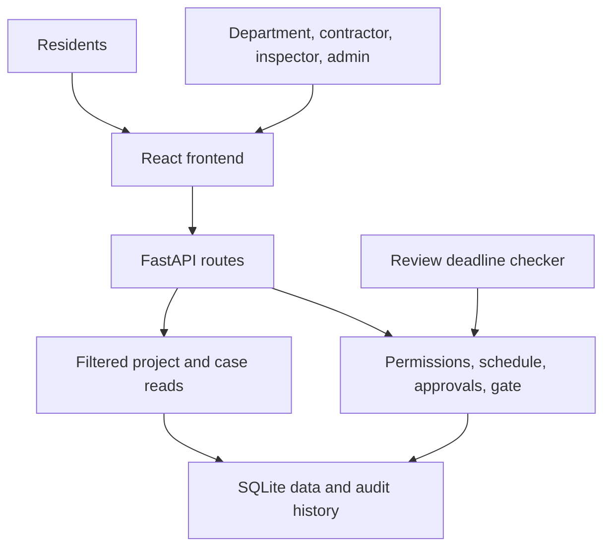

# WorkSync — architecture and six-hour work plan

This is a proposed local-demo architecture; no application has been implemented by these planning files.

## 1. Understand the three parts

| Part | What it does | Your tool/workflow |
|---|---|---|
| Frontend | Screens, forms, buttons and clear feedback | Design in Stitch/Figma; implement/reuse exported frontend code where available |
| Backend | Checks who may act, calculates schedules, manages approvals and decides whether work can start | Claude implements FastAPI from the backend prompt |
| Database | Remembers projects, versions, decisions, inspections and audit history after restart | SQLite, managed only by the backend |

**API = the agreed language between the frontend and backend.** The frontend sends a request such as “start this project”; the backend returns success or specific blockers. The frontend never writes directly to SQLite.

Stitch/Figma and Claude are development tools, not required running components of the completed local app.

The diagram shows runtime responsibility. Every mutation uses one backend transaction; the diagram does not imply several services or databases.

## 2. One concrete example

You click **Authorise and start now** for final resurfacing. React sends `POST /api/v1/projects/surface-1/start` with the selected contractor and current versions. FastAPI checks the actual database: is the current plan approved, are all utilities complete and inspected, are declarations valid, and is today permitted?

If Power's declaration is missing, the backend returns a blocked result. React displays “Power department must confirm its planned work.” It does not independently decide that the requirement can be ignored. If all checks pass, the same transaction records the start, PCC and audit event. A reload shows the saved result.

## 3. What to give each tool

1. **Claude:** `WORKSYNC_BACKEND_CLAUDE_PROMPT.md` + `WORKSYNC_API_CONTRACT.md`. Request backend code only at this stage.
2. **Stitch/Figma:** `WORKSYNC_FRONTEND_STITCH_FIGMA_BRIEF.md` + the same API contract + your template/screenshots.
3. **Integration:** give Claude the generated frontend source if available. If you only have frames/screenshots, request a small React implementation matching them, then wire it to the existing backend. Budget more implementation time when no frontend source exists.

Do not attach the full long-term coordination specification as another mandatory build scope. These reduced briefs define this demonstration. Before wiring, compare FastAPI's `/openapi.json` with the shared contract and fix naming differences in one place.

## 4. Six-hour target

The design work overlaps backend development. This is one six-hour target, not six hours for each tool; actual duration depends on environment setup and whether usable frontend code is available.

| Elapsed time | Backend track | Your frontend/integration track |
|---|---|---|
| 0–1h | Database, routes, seed and demo identities | Supply template; settle four screens and form fields |
| 1–2h | Scheduler, case grouping and plan versions | Complete mobile/desktop design and action states |
| 2–3h | Contractor/department decisions and permissions | Prepare frontend source or implement frames in React |
| 3–4h | Gate, inspections, declarations, audit and deadlines | Check components against API fixtures |
| 4–5h | Resolve contract gaps and endpoint issues | Connect `api.ts`, forms, selected user, errors and refresh |
| 5–6h | Run integrity tests and fix blockers | Complete one real walkthrough, reload/restart, simplify polish |

If there is no runnable frontend by hour 3, use a plain React version of the approved layout. Defer visual refinements. Do not replace backend decisions with hardcoded UI state to finish faster.

## 5. Integration request to give Claude later

Connect this frontend to the existing WorkSync backend using WORKSYNC_API_CONTRACT.md. Preserve the chosen layout. Put HTTP calls in one api.ts client and configure VITE_API_BASE_URL. Replace mock state with server reads, send current versions and idempotency keys, and display structured errors. Do not recreate scheduling, permissions or clearance rules in React. Verify the complete approval-and-inspection flow, a denied paving attempt and successful paving; report any real API differences before changing the contract. Keep working backend behaviour intact.

## 6. Done means

- Frontend actions change the database through real endpoints.
- Contractors and departments act only on their own scope and current versions.
- Missing inspection/declaration blocks paving even through a direct API request.
- Public dates distinguish proposal, agreement, report and verification.
- Reload and backend restart preserve state and history.
- The final demo uses no maps or external service credentials.
